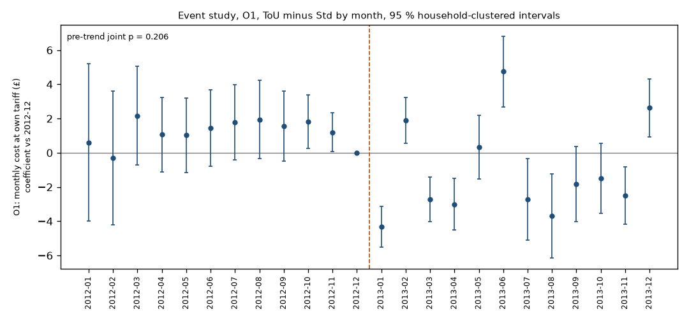
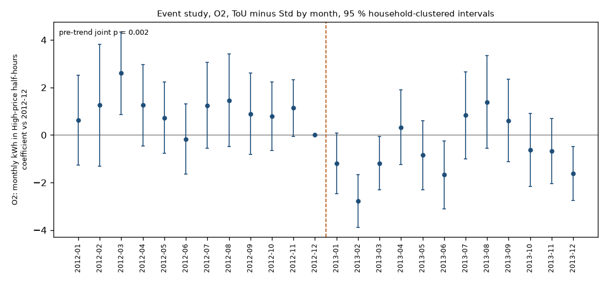

# lcl-dtou-causal

A pre-registered difference-in-differences and event study of the Low Carbon London dynamic time-of-use (dToU) tariff trial, on the public half-hourly readings of 5,566 London households (UK Power Networks, 2011 to 2014, CC BY 4.0). About 1,100 households paid day-ahead prices of 67.20, 11.76 or 3.99 pence per kWh through 2013 and the rest paid 14.228 pence flat. The question is what the tariff did to a household's monthly bill at its own tariff and to its use in High-price half-hours, with the bill at the dToU schedule, total kWh and Low-price kWh as secondary outcomes. The analysis plan was written and hash-frozen before the data was downloaded, and every number below is read from `results/*.json` by the test suite.

One point decided the design. The unit's specification expected that assignment was randomised, DiD is the robustness design under that expectation. The trial's own report (Low Carbon London Learning Report A3, Imperial College London, 2014, printed pages 22 to 24) says the trial was opt-in at both stages: households volunteered for the dToU tariff with a £100 sign-up and £50 completion incentive, and the authors assumed self-selection had created a difference between the groups. So here the two-way fixed effects difference-in-differences is the primary design, the post-period comparison with a pre-period covariate is the secondary check, and the pre-trend test and placebos carry the weight. Both estimators agree on every outcome.

## Results

Full run on the committed household-month panel, 500 permutations, regenerated by `python -m lcl_dtou_causal analyse` then `python -m lcl_dtou_causal memo`. The smoke run (`python -m lcl_dtou_causal smoke`, 300 households, 100 permutations) writes `results/smoke.json` and never these numbers. `tests/test_readme_numbers.py` asserts every value in this block.

<!-- results:start -->
| Outcome | 2012 mean, ToU group | ATT (DiD) | 95 % CI | Clustered SE | ATT as % of 2012 mean | Pre-trend p (joint) | Placebo-date estimate | Permutation p (500) | ANCOVA estimate (the check that would be primary under randomisation) | Households (ToU / Std) | Months (pre / post) |
|---|---|---|---|---|---|---|---|---|---|---|---|
| O1, monthly cost at own tariff (£) | 39.76 £ | -2.40 £ | [-3.06, -1.73] | 0.34 | -6.0 % | 0.206 | 0.42 [-0.52, 1.35] | 0 of 500 (p < 0.002) | -2.22 [-2.85, -1.59] | 862 / 3389 | 12 / 12 |
| O2, monthly kWh in High-price half-hours | 14.57 kWh | -1.46 kWh | [-1.77, -1.15] | 0.16 | -10.0 % | 0.002 | 0.54 [-0.08, 1.17] | 0 of 500 (p < 0.002) | -1.32 [-1.62, -1.02] | 862 / 3389 | 12 / 12 |
| O3, monthly cost at the dToU schedule (£) | 39.07 £ | -1.94 £ | [-2.60, -1.28] | 0.34 | -5.0 % | 0.018 | not pre-registered | not pre-registered | -1.74 [-2.37, -1.12] | 862 / 3389 | 12 / 12 |
| O4, total monthly kWh | 279.44 kWh | -9.28 kWh | [-13.91, -4.65] | 2.36 | -3.3 % | 0.209 | not pre-registered | not pre-registered | -8.15 [-12.50, -3.80] | 862 / 3389 | 12 / 12 |
| O5, monthly kWh in Low-price half-hours | 24.00 kWh | 0.45 kWh | [-0.09, 1.00] | 0.28 | 1.9 % | 0.068 | not pre-registered | not pre-registered | 0.82 [0.33, 1.31] | 862 / 3389 | 12 / 12 |

Sample: 862 ToU and 3389 Std households, 84,713 household-months, January 2012 to December 2013. Attrition from the raw release to the kept sample: 23.7 % of Std and 23.2 % of ToU households. 2012 balance on total kWh per month: ToU 279.4, Std 300.7, Welch p 0.002. Pre-registration sha256 `973b734c7e04768e23e2a5fc6628a67a3e17c4dcd6fdd8832055e8cdb58cbaf1`. Placebo-date estimates are for a false treatment date of July 2012 inside the pre-period. Permutation p is the share of 500 random relabellings whose absolute estimate reaches the observed one. The ANCOVA column regresses each household's 2013 mean on its group and its 2012 mean, the comparison that would have been primary had assignment been randomised.
<!-- results:end -->

The bill effect (O1) is the effect of being on the tariff, price structure and behaviour together, which is what a household sees. O1 passes the pre-trend test, O2 does not: the 2012 event-study coefficients for High-price use sit about one kWh above the December 2012 reference with no trend in either direction, so the O2 estimate depends on December 2012 being an ordinary month for the gap between the groups. Read O2 as suggestive. Total use fell by about three percent and Low-price use did not rise by a detectable amount, so the High-price reduction reads as avoided use rather than shifted use. The effect scales with 2012 usage (`results/heterogeneity.json`).

## Event studies

One coefficient per month on ToU times month, household and month fixed effects, errors clustered by household, December 2012 the reference. The dashed line is the start of the dToU year.





Figures for O3 to O5 are in `docs/`. The twelve pre-period and twelve post-period coefficients with intervals are in `results/event_study.json`.

## Placebos

A false treatment date of July 2012 inside the pre-period gives intervals that cover zero for both primary outcomes. Reassigning the ToU label at random 500 times with the group sizes held, none of the permuted estimates reaches the observed O1 or O2 estimate (`results/placebo.json`, seed 20261028). The permutation estimator is an alternating-projection two-way demeaning whose observed estimate equals the PanelOLS estimate to the fourth decimal, recorded as `fast_minus_panelols`.

## Source, licence and attribution

Dataset: "SmartMeter Energy Consumption Data in London Households", UK Power Networks (Low Carbon London), London Datastore, https://data.london.gov.uk/dataset/smartmeter-energy-use-data-in-london-households , licence "Creative Commons Attribution" linking to CC BY 4.0. Files used: `Partitioned LCL Data.zip` (795,722,689 bytes, 167,932,474 rows in 168 CSV files) and `Tariffs.xlsx` (the 2013 half-hour schedule). Their sha256 values and the verification checks are in `results/download_check.json`. Prices come from Report A3 (printed pages 5 and 32) and the dataset description, which agree. `LICENCE_CHECK.md` has every row.

Attribution line carried by `data/derived/LICENCE`: Contains data from "SmartMeter Energy Consumption Data in London Households", UK Power Networks (Low Carbon London), published on the London Datastore under the Creative Commons Attribution 4.0 International licence (https://creativecommons.org/licenses/by/4.0/). Changes: aggregated from half-hourly readings to household-month totals and joined to the 2013 dynamic time-of-use price schedule.

No raw half-hourly row is committed. `data/derived/panel_monthly.parquet` (household-month aggregates, pseudonymous ids as published), its sensitivity twin `panel_monthly_bst_shift.parquet` and `data/derived/dtou_schedule_2013.parquet` are committed under CC BY 4.0 so the smoke run and the tests work without the 10 GB download.

## Pre-registration

`PREREGISTRATION.md` was written on 2026-10-28 before any download. `python -m lcl_dtou_causal prereg freeze` recorded its sha256 in `results/preregistration_sha256.json` in a commit of its own. `tests/test_prereg_hash.py` checks the file still matches, `tests/test_prereg_order.py` reads `git log` and checks that the plan was committed before the freeze and the freeze before any result file other than the download check. Every analysis command refuses to run on a mismatch unless `--deviation <id>` names an entry in `DEVIATIONS.md`. The plan was not edited after the freeze. `DEVIATIONS.md` holds one entry, D1, which adds a sensitivity run outside the Results table (next section) and changes no outcome, group, period or estimator.

## Design in ten lines

1. Treated: households flagged `ToU`. Control: `Std`. Pre: January to December 2012 (both on the flat rate). Post: January to December 2013.
2. Sample: January 2012 to December 2013 only, duplicates averaged, a household-month needs 80 % of its half-hours, a household needs six valid months in each year.
3. O1 bill at own tariff (£), O2 kWh in High-price half-hours, O3 bill at the dToU schedule, O4 total kWh, O5 kWh in Low-price half-hours.
4. The 2013 schedule is mapped onto 2012 by calendar date and clock time so band outcomes exist in both years.
5. E1 DiD: household and month fixed effects, coefficient on ToU times Post, errors clustered by household.
6. E2 event study: one coefficient per month against December 2012, joint Wald test on the eleven free pre-period coefficients.
7. E3 check: each household's 2013 mean on its group and its 2012 mean, HC1 errors.
8. P1 placebo date July 2012 inside the pre-period. P2 500 random relabellings holding the group sizes.
9. Heterogeneity by 2012 usage terciles, secondary.
10. No decision thresholds. The memo reports what is found. `docs/memo.md` and `docs/partner_slide.md` are generated from the result files.

## Caveats

Opt-in trial with cash incentives and a guarantee that nobody would be worse off, London only, 2013 only, early smart-meter adopters without prepayment meters, micro-generation, Economy 7 or dual-fuel contracts, day-ahead notification, one year of treatment. The fixed effects remove level differences between the groups but not a different response to 2013's weather. The O2 pre-trend test fails. Bills are unit rates only.

Time frame. Report A3 states the event schedule in local time and kept events off the clock-change days. The readings carry 01:00 and 01:30 labels on 31 March 2013, an hour that did not exist in local time, so they are most likely stamped in a fixed GMT frame, and the pre-registered join on equal labels is then one hour off during British Summer Time for every outcome that uses the schedule (`results/timeframe_check.json` holds the evening-peak evidence, which is mixed). The pre-registered join was kept and is what the Results table reports. A sensitivity run with the schedule moved back one hour inside British Summer Time before the join (`DEVIATIONS.md` D1, `results/sensitivity_timeframe.json`) re-estimates every outcome, and the memo quotes both sets of numbers. Nothing here says anything about households outside the trial.

## How to run

```
C:/Users/nagar/anaconda3/python.exe -m venv .venv
.venv\Scripts\pip install -e .[dev]
.venv\Scripts\python -m pytest -q
.venv\Scripts\python -m lcl_dtou_causal smoke
```

Full pipeline, in order: `prereg freeze` (done once, committed), `download` (about 800 MB, resumes, extracts 10 GB under `data/raw/`, gitignored), `schedule`, `panel` (one DuckDB pass, about 75 s on this PC), `analyse --permutations 500` (about 20 s), `memo`. Sensitivity: `panel --variant bst-shift` then `analyse --sensitivity-timeframe`. No key, no paid call: `prices.json` and `costcap.py` from the workspace template are unused and spend is zero.

## Tests

The three template tests (smoke under ten minutes, no secrets, README numbers), `test_prereg_hash.py`, `test_prereg_order.py`, `test_panel_rules.py` (the sample rules and the cost arithmetic on a synthetic half-hourly table with known violations), `test_did_recovers_known_effect.py` (an injected 10 % effect on a synthetic self-selected panel is recovered within the 95 % interval, and the permutation estimator equals PanelOLS), `test_placebo.py`, `test_derived_licence.py` and `test_docs.py`.

## Licence

Code: MIT, Avinash Nagarajan. Derived data under `data/derived/`: CC BY 4.0 with the attribution above.
